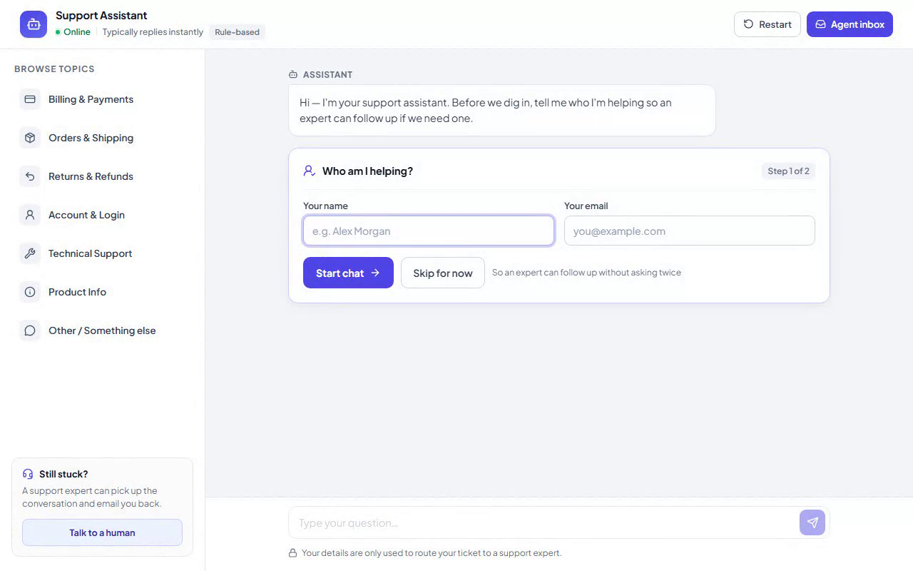
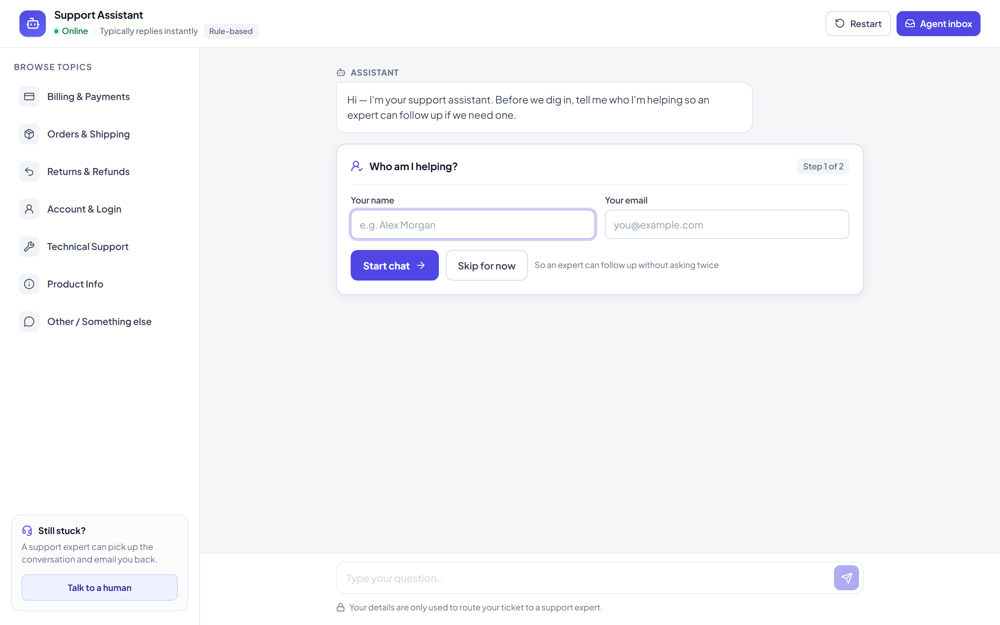
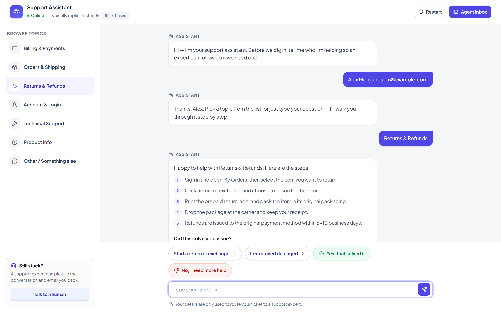
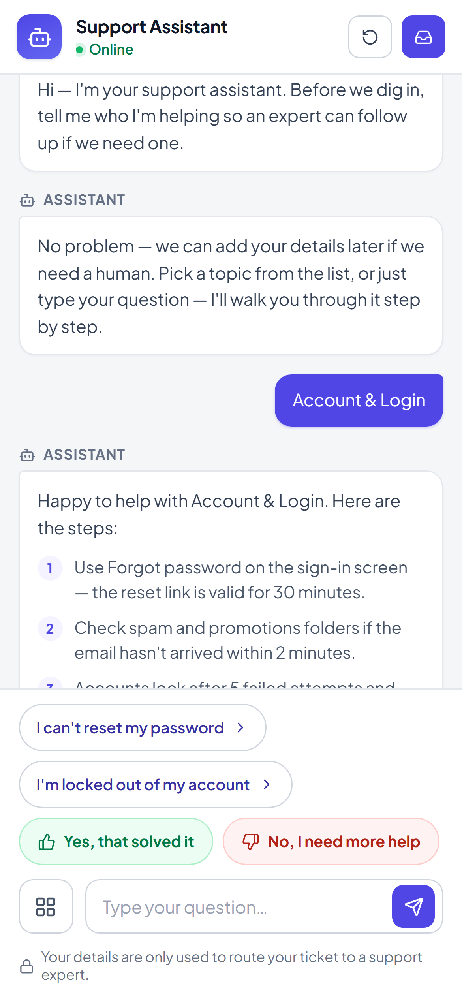
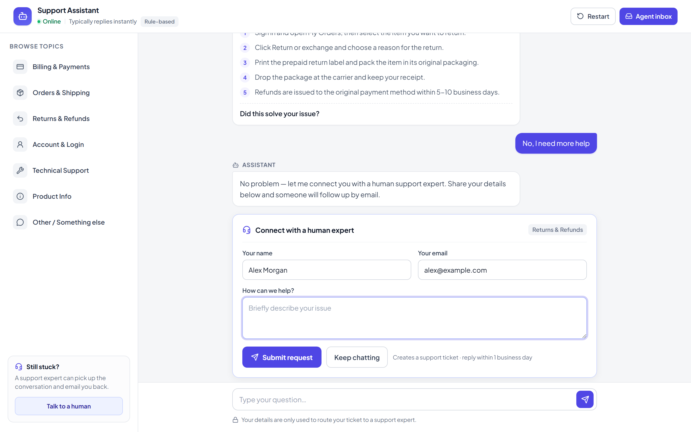
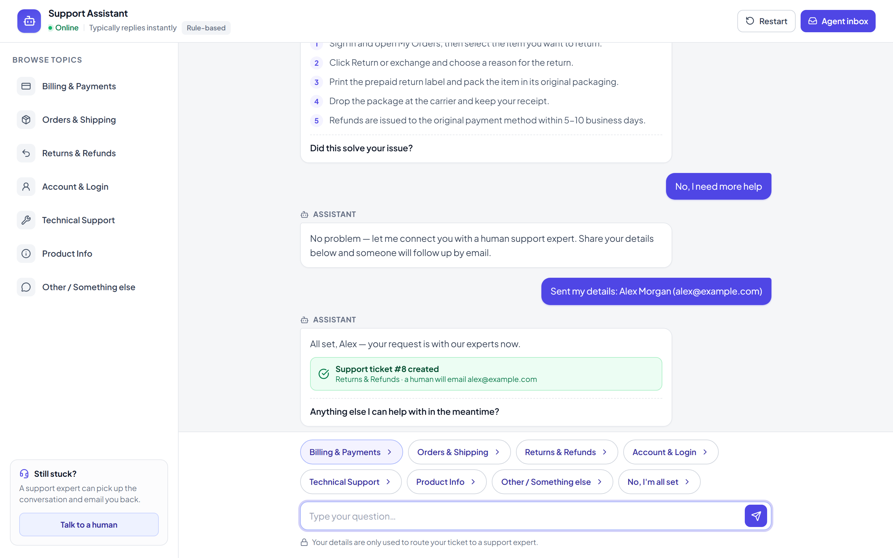
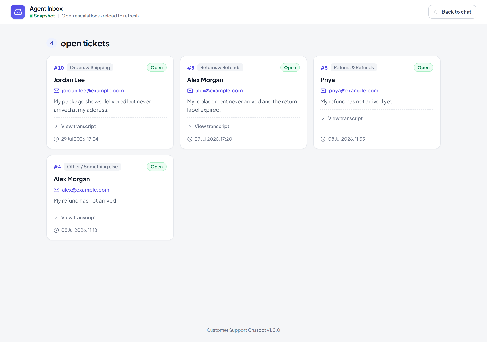

# 🤖 Customer Support Chatbot

A genuinely useful **customer support assistant** (CodeAlpha Task 4) — it asks who
it's helping, guides them through step-by-step instructions, checks if they're
satisfied, and escalates to a **human expert** via a support ticket when needed.
Ships with a colorful CLI and a responsive web chat widget over one shared engine.

---

## 🎬 Demo Video

A full walkthrough — intake → category → steps → satisfied? → escalate → ticket
→ agent inbox. Click the poster to play
[`screenshots/demo.mp4`](screenshots/demo.mp4):

[](screenshots/demo.mp4)

---

## 📸 Screenshots

### 👋 Intake gate

The conversation opens by asking **"Who am I helping?"** — a name and email so an
expert can follow up without asking twice. It's skippable, and the composer stays
dimmed until the gate is cleared.



### 💬 Chat widget (topics + step-by-step instructions)

A topic rail lists Billing, Orders & Shipping, Returns & Refunds, Account & Login,
Technical, Product Info and Other — or the customer can just type a question. The
bot answers with **numbered steps**, then asks **"Did this solve your issue?"**
with **Yes / No** replies.



### 📱 Responsive

The shell adapts on its **own container width** (via `ResizeObserver`), not just
the viewport. On narrow layouts the topic rail collapses into a grid button
beside the composer.



### 🧑‍💼 Escalation to a human

On **"No"** (or "talk to a human"), the bot collects contact details and creates a
support **ticket** — confirming a human expert will follow up.



### 🎫 Ticket created

Submitting the escalation form creates a support ticket and confirms a human
expert will follow up.



### 📥 Agent inbox

Escalations land in the experts' inbox at `/agent`, each with the customer's
details and the full conversation transcript.



---

## ▶️ Run it

```bash
pip install -r requirements.txt
python -m chatbot             # colorful terminal chat
python web/app.py             # web UI at http://127.0.0.1:5000 (customer)
                               # agent inbox at http://127.0.0.1:5000/agent
```

Optional AI fallback (free-text the rule-based matcher can't handle): copy
`.env.example` to `.env` and set an Anthropic API key. The chatbot works fully
without it — the rule-based path always works.

## 📁 Project Structure

```
support-navigator/
├── src/chatbot/
│   ├── __init__.py          # __version__
│   ├── __main__.py          # python -m chatbot
│   ├── knowledge.py         # KB loader
│   ├── matcher.py           # free-text NLU
│   ├── engine.py            # conversation state machine
│   ├── ai.py                # optional Claude fallback
│   ├── tickets.py           # SQLite ticket store
│   ├── cli.py               # colored terminal UI
│   └── data/
│       └── knowledge_base.json
├── web/
│   ├── app.py               # Flask app
│   ├── templates/           # chat.html, agent.html
│   │   └── _icons.html      # GENERATED lucide sprite - do not edit by hand
│   └── static/               # style.css, chat.js
├── tools/
│   └── icontool.py          # regenerates _icons.html from the lucide package
├── tests/                   # pytest suite
├── screenshots/
├── pyproject.toml           # pip install -e . ; support-bot script
├── requirements.txt
├── .env.example
└── README.md
```

## 🎨 Icons

The UI is drawn with [lucide](https://lucide.dev) icons, served as a single
inline SVG sprite (`web/templates/_icons.html`) and used like this:

```html
<svg class="icon"><use href="#i-inbox"></use></svg>
```

That sprite is generated from the [`lucide` PyPI package](https://pypi.org/project/lucide/)
(pinned in `requirements.txt`) by `tools/icontool.py` — icon path data is never
hand-transcribed. `lucide` is a build-time dependency only; the running app just
serves the generated sprite and never imports the package.

```bash
python tools/icontool.py          # regenerate the sprite
python tools/icontool.py check    # verify it's up to date (exit 1 if not)
```
